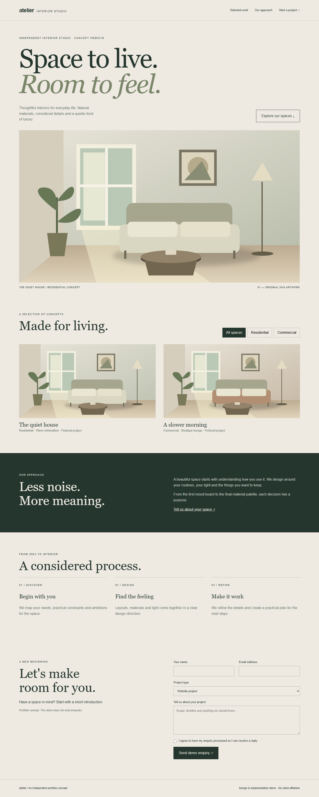
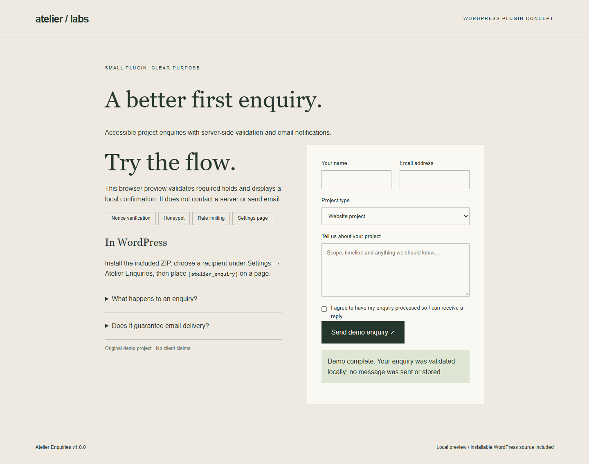

# Siarhei — WordPress demo portfolio

Two original, self-initiated projects created with AI assistance. These are portfolio concepts, not paid client case studies.

## Explore the projects

Download [demo-portfolio.zip](demo-portfolio.zip?raw=true), extract it, and open **index.html** in your browser. No installation, internet connection or WordPress is needed for the previews.

The archive includes complete source code, two installable WordPress ZIPs, desktop/mobile screenshots, setup instructions and verification notes.

### Atelier Studio

A responsive website concept for an interior studio, with editorial typography, original SVG illustrations, mobile navigation, project filtering and reduced-motion support. Includes a classic WordPress theme.

### Atelier Enquiries

A custom WordPress enquiry plugin with a shortcode form, configurable notification recipient, server-side validation, nonce verification, a honeypot and basic rate limiting. Its browser preview simulates submission locally and sends no data.

## WordPress setup

In the extracted archive, install **packages/atelier-studio.zip** through Appearance → Themes, and **packages/atelier-enquiries.zip** through Plugins. Set the recipient under Settings → Atelier Enquiries. Add `[atelier_enquiry]` to a page; the companion theme also displays the form on its front page.

Browser previews passed checks for desktop/mobile layouts, navigation, project filters, form validation and JavaScript errors. WordPress activation, PHP runtime and real email delivery still require staging verification. See README.md and VERIFICATION.md inside the archive for limits and the test checklist.

## Contact

[Idea To Action — Telegram](https://t.me/IdeaToActionn). A recently created channel where I plan to publish projects and share my development process.

Original preview code and SVG illustrations: MIT. WordPress theme and plugin PHP: GPL-2.0-or-later. See the license notice included in the archive.
